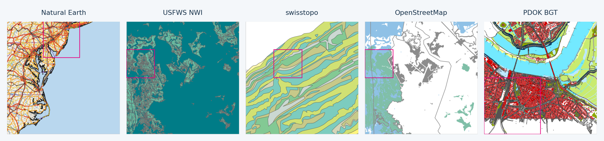
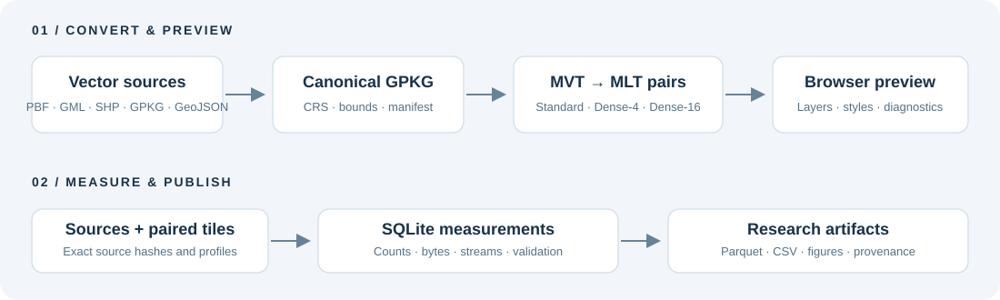

> **Primary experiment update (2026-11-06).** Five variants (Standard, Aggregated-4/16, Dense-4/16), MVT and Rust MLT v1/v2, source-feature provenance and matched-block effect decomposition are now defined in [the extended experiment guide](docs/extended_experiment.md). Run `python manage.py experiment`, then `python manage.py all`. Primary summaries live in `docs/data/extended/results.sqlite`; generated CSV/TeX files use `extended_` prefixes. The three-variant Python workflow and numerical claims below describe the historical study.

# GEOMAPS

[](LICENSE)

**From vector sources to reproducible MVT / MLT compression measurements.**

The converter and host analysis pin `maplibre-tiles==0.4.1`. Existing research
archives retain their original encoder provenance; upgrading the validator does
not re-encode archives or change compression measurements. Host setup builds the
budget-enabled binding from source and requires Rust 1.98 or newer plus native
build tools (Visual C++ on Windows). Docker supplies its own Rust build stage.

[](https://doi.org/10.5281/zenodo.23452598)
[](https://doi.org/10.5281/zenodo.23456861)


GEOMAPS tests how tile granularity affects column-oriented vector-map compression.
It normalizes vector sources, generates paired tile pyramids, previews maps in a
browser, measures their contents, and exports research data in SQLite, Parquet and CSV.

Companion code for **Does Tile Granularity Matter? An Empirical Study of Vector
Tile Compression for Map Rendering with MapLibre Tiles**.
If you use the software or measurements, please [cite the corresponding software
release and dataset](#citation).



*Illustrative panels from the article's Standard MVT archives. Sources, left to
right: Natural Earth; USFWS NWI; swisstopo; © OpenStreetMap contributors (ODbL);
PDOK BGT. [Attribution and terms](docs/sources.md).*

## Start here

| Goal | Guide |
|---|---|
| Go from original map files to a complete dataset upload package | [End-to-end walkthrough](docs/end-to-end.md) |
| Convert a map, select an area and preview styles | [Conversion and preview](docs/usage.md) |
| Reproduce statistics, tables and images | [Analysis workflow](analysis/README.md) |
| Use the published measurements without source maps | [Dataset guide](docs/dataset.md) |
| Understand weighting, units and missing values | [Data dictionary](docs/data_dictionary.md) · [Every table and column](docs/schema.md) |
| Prepare a GitHub / Zenodo release | [Release guide](docs/releasing.md) |

## Quick start

Install Python 3.12–3.14, [uv](https://docs.astral.sh/uv/) and Docker with Compose v2.
Use a terminal in this repository. The same commands work in PowerShell and Linux:

```sh
python manage.py env
python manage.py up
```

Open **http://localhost:8080**. Upload a vector source or import a URL/local file,
set the normalization bounds, inspect the layer plan, normalize to GeoPackage,
then generate the MVT/MLT archives. Preview the Standard pair and adjust layer styling.
Docker provides GDAL and the PMTiles CLI; no separate GDAL or Java setup is needed.
The first start builds both images. Data persists in `app/data`.
Try the synthetic [three-point example](examples/README.md) before importing a large map.

```sh
python manage.py logs
python manage.py down
```

## Two reproducible workflows



| Variant | Detail at stored zoom z | Coordinate extent |
|---|---|---:|
| Standard | Standard z | 4096 |
| Dense-4 | Standard z+1 | 8192 |
| Dense-16 | Standard z+2 | 16384 |

MLT is transcoded from the corresponding MVT payloads. It is never tiled
independently. Extents scale with density; shared simplification settings control
detail. Pair validation records coordinate sets, layers, features, attributes and
geometry diagnostics. [Experimental design](docs/experiment.md).

With original sources, normalized GeoPackages and paired tile archives at the
paths in [`analysis/datasets.json`](analysis/datasets.json), run analysis directly
without Docker or repeated conversion. See the
[existing-artifacts workflow](docs/end-to-end.md#already-have-normalized-maps-and-tile-archives).

```sh
python manage.py all
python manage.py maps
python manage.py export-dataset --output releases/dataset-v1
```

`all` writes measurements and CSV inputs into `docs/data`, tables into
`outputs/tables`, and charts into `outputs/figures`. `maps` renders curated map
panels. Tile measurements are stored as Parquet tables in `docs/data/tile_stats/`
and queried directly with DuckDB. `export-dataset` creates `tile_stats_parquet.zip`,
five consistent SQLite snapshots with Parquet/CSV bundles, a schema, provenance
and checksums. No tile-statistics SQLite copy is created or retained. The exporter
refuses to overwrite an existing release. Review **`claims_report.md`** before publishing.

## Supported inputs and limits

The supported research path is **vector source → GeoPackage → MVT/MLT PMTiles**.
Inputs include GDAL-readable OSM PBF, GeoPackage, GeoJSON, Shapefile, GeoParquet,
GML/CityGML and supported Interlis sources. ZIP imports select a usable vector
member; sidecars and layer mappings matter. Support depends on the GDAL driver's
ability to read a specific source; an extension alone is not a guarantee.
Raster inputs and arbitrary existing tile archives are outside this workflow.

Normalization bounds select intersecting features and clip their geometry before
reprojection. Tile features are instances, so cross-boundary objects may
appear more than once. Dense variants change clipping boundaries; their vertex
counts need not match Standard. Large no-drop tiles can require substantial RAM
and scratch space. See [usage](docs/usage.md) for precision and validation settings.

Known research limitations remain visible: stable-ID completeness from normalized
features to tiles is pending; parser results lack a second independent parser
cross-check; historical source acquisition metadata is incomplete; strict pair
differences do not establish a cause; traffic results are outside these pipelines.
Unknown bounds and missing measurements remain unknown, not zero or pass.
This repository does not claim to reproduce the separate browser traffic study.

## Verification

```sh
python manage.py test
uv run --frozen pytest
```

Tests generate tiny vector and MVT/MLT PMTiles fixtures locally; no corpus download
is required. CI runs on Windows and Linux, plus frontend tests and a production
build. [Validation and release status](docs/releasing.md).

## Citation

Please cite the software when using this code, and the dataset when using its
measurements. Both works are by Viacheslav Nefedov, Ivan Nefedov, Petr Datsenko
and Samuil Datsenko.

### Software

For software version 0.1.0, use:

> Nefedov, V., Nefedov, I., Datsenko, P., & Datsenko, S. (2026).
> *GEOMAPS: sparse-pyramid MVT and MLT compression* (Version 0.1.0)
> [Computer software]. Zenodo. https://doi.org/10.5281/zenodo.23456861

```bibtex
@misc{nefedov2026geomaps,
  author = {Nefedov, Viacheslav and Nefedov, Ivan and Datsenko, Petr and Datsenko, Samuil},
  title  = {{GEOMAPS}: sparse-pyramid {MVT} and {MLT} compression},
  year   = {2026},
  note   = {Computer software, version 0.1.0},
  doi    = {10.5281/zenodo.23456861},
  url    = {https://doi.org/10.5281/zenodo.23456861}
}
```

This DOI identifies version 0.1.0. Cite the version you actually used.

### Dataset

> Nefedov, V., Nefedov, I., Datsenko, P., & Datsenko, S.
> *Vector Tile Compression for Map Rendering with MapLibre Tiles: Tile-Level
> Measurements of MVT and MLT Across Five Datasets* [Data set]. Zenodo.
> https://doi.org/10.5281/zenodo.23452598

```bibtex
@misc{nefedov_mvt_mlt_measurements,
  author       = {Nefedov, Viacheslav and Nefedov, Ivan and Datsenko, Petr and Datsenko, Samuil},
  title        = {Vector Tile Compression for Map Rendering with {MapLibre Tiles}:
                  Tile-Level Measurements of {MVT} and {MLT} Across Five Datasets},
  howpublished = {Zenodo},
  note         = {Data set},
  doi          = {10.5281/zenodo.23452598},
  url          = {https://doi.org/10.5281/zenodo.23452598}
}
```

Machine-readable citation metadata, author ORCIDs and affiliations are in
[CITATION.cff](CITATION.cff). The article's arXiv identifier will be added after
publication.

The project code is licensed under the [MIT License](LICENSE). Third-party assets
and source datasets retain their [upstream terms](docs/sources.md).

The validator uses a source-verified binding patch of 0.4.1 that adds
`max_memory_bytes` to `decode_mlt` and `decode_mlt_to_geojson`. Both the Rust
parser and decoder receive the budget. `MLT_DECODE_MEMORY_MIB` defaults to **256**;
this native allocation budget does not include all Python/WKB memory or replace
the Docker RAM quota. `manage.py env` and Docker builds install this binding.
For a manually managed environment, run:

```sh
python app/converter/build_mlt.py --install
```

The builder verifies the official source archive SHA-256 before applying the
binding-only patch. Encoder behavior and the 0.4.1 wire format are unchanged.

See the [0.4.1 validation record](docs/validation/mlt-0.4.1.md) and
[per-tile memory probe](docs/validation/mlt-0.4.1-memory.json).
