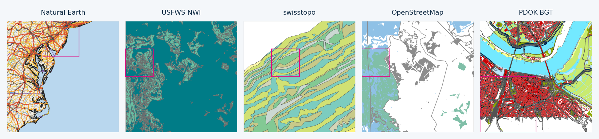
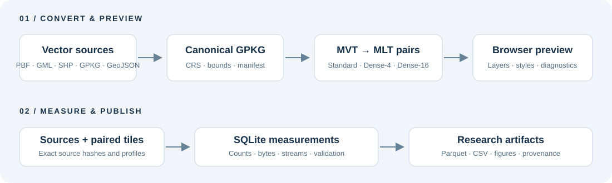

# GEOMAPS

[](LICENSE)

**From vector sources to reproducible MVT / MLT compression measurements.**

[](https://doi.org/10.5281/zenodo.23452598)


GEOMAPS tests how tile granularity affects column-oriented vector-map compression.
It normalizes vector sources, generates paired tile pyramids, previews maps in a
browser, measures their contents, and exports research data in SQLite, Parquet and CSV.



*Illustrative panels from the article's Standard MVT archives. Sources, left to
right: Natural Earth; USFWS NWI; swisstopo; © OpenStreetMap contributors (ODbL);
PDOK BGT. [Attribution and terms](docs/sources.md).*

## Start here

| Goal | Guide |
|---|---|
| Convert a map, select an area and preview styles | [Conversion and preview](docs/usage.md) |
| Reproduce statistics, tables and images | [Analysis workflow](analysis/README.md) |
| Use the published measurements without source maps | [Dataset guide](docs/dataset.md) |
| Understand weighting, units and missing values | [Data dictionary](docs/data_dictionary.md) · [Every table and column](docs/schema.md) |
| Prepare a GitHub / Zenodo release | [Release guide](docs/releasing.md) |

## Quick start

Install Python 3.12–3.14, [uv](https://docs.astral.sh/uv/) and Docker with Compose v2.
Use a terminal in this repository. The same commands work in PowerShell and Linux:

```sh
python manage.py env
python manage.py up
```

Open **http://localhost:8080**. Upload a vector source or import a URL/local file,
set the normalization bounds, inspect the layer plan, normalize to GeoPackage,
then generate the MVT/MLT archives. Preview the Standard pair and adjust layer styling.
Docker provides GDAL and the PMTiles CLI; no host GDAL or Java setup is needed.
The first start builds both images. Data persists in `app/data`.
Try the synthetic [three-point example](examples/README.md) before importing a large map.

```sh
python manage.py logs
python manage.py down
```

## Two reproducible workflows



| Variant | Detail at stored zoom z | Coordinate extent |
|---|---|---:|
| Standard | Standard z | 4096 |
| Dense-4 | Standard z+1 | 8192 |
| Dense-16 | Standard z+2 | 16384 |

MLT is transcoded from the corresponding MVT payloads. It is never tiled
independently. Extents scale with density; shared simplification settings control
detail. Pair validation records coordinate sets, layers, features, attributes and
geometry diagnostics. [Experimental design](docs/experiment.md).

Once all five corpus inputs and paired outputs exist at the paths in
[`analysis/datasets.json`](analysis/datasets.json):

```sh
python manage.py all
python manage.py maps
python manage.py export-dataset --output releases/dataset-v1
```

`all` writes measurements and CSV inputs into `docs/data`, tables into
`outputs/tables`, and charts into `outputs/figures`. `maps` renders curated map
panels. `export-dataset` creates six consistent SQLite snapshots, corresponding
Parquet/CSV bundles, a schema, provenance and checksums. It refuses to overwrite
an existing release. Review **`claims_report.md`** before publishing.

## Supported inputs and limits

The supported research path is **vector source → GeoPackage → MVT/MLT PMTiles**.
Inputs include GDAL-readable OSM PBF, GeoPackage, GeoJSON, Shapefile, GeoParquet,
GML/CityGML and supported Interlis sources. ZIP imports select a usable vector
member; sidecars and layer mappings matter. Support depends on the GDAL driver's
ability to read a specific source; an extension alone is not a guarantee.
Raster inputs and arbitrary existing tile archives are outside this workflow.

Normalization bounds select intersecting features and clip their geometry before
reprojection. Tile features are instances, so cross-boundary objects may
appear more than once. Dense variants change clipping boundaries; their vertex
counts need not match Standard. Large no-drop tiles can require substantial RAM
and scratch space. See [usage](docs/usage.md) for precision and validation settings.

Known research limitations remain visible: stable-ID completeness from normalized
features to tiles is pending; parser results lack a second independent parser
cross-check; historical source acquisition metadata is incomplete; strict pair
differences do not establish a cause; traffic results are outside these pipelines.
Unknown bounds and missing measurements remain unknown, not zero or pass.
This repository does not claim to reproduce the separate browser traffic study.

## Verify and cite

```sh
python manage.py test
uv run --frozen pytest
```

Tests generate tiny vector and MVT/MLT PMTiles fixtures locally; no corpus download
is required. CI runs on Windows and Linux, plus frontend tests and a production
build. [Validation and release status](docs/releasing.md).

Authors: Viacheslav Nefedov, Ivan Nefedov, Petr Datsenko and Samuil Datsenko.
ORCIDs are in [CITATION.cff](CITATION.cff). Cite the software release DOI assigned
by Zenodo separately from the [dataset DOI](https://doi.org/10.5281/zenodo.23452598).
The software DOI and arXiv identifier are added after publication; neither is
invented here. Source material retains its [upstream terms](docs/sources.md).
The project code is licensed under the [MIT License](LICENSE). Third-party assets
and source datasets retain their own terms.
